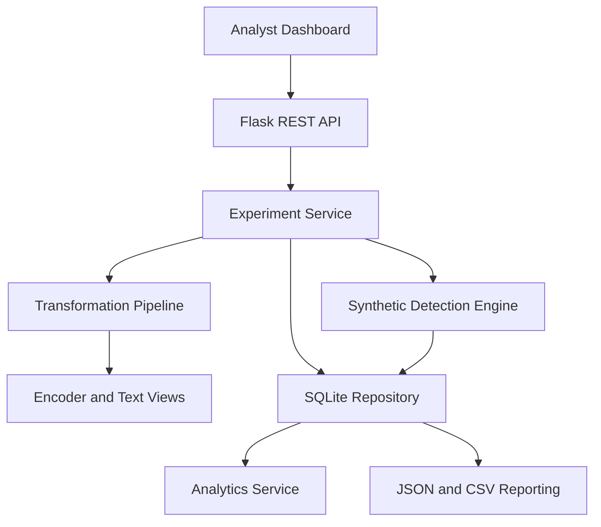

# Architecture

## Design boundaries
- Flask application factory separates setup from runtime.
- API routes validate requests and delegate to services.
- Core transformation and detection logic is independent of Flask.
- SQLite persists experiment metadata, hashes, configuration and results.
- Raw sample text is not persisted in the database.
- No subprocess, shell, network scanning, payload execution or external AV/EDR integration exists.
